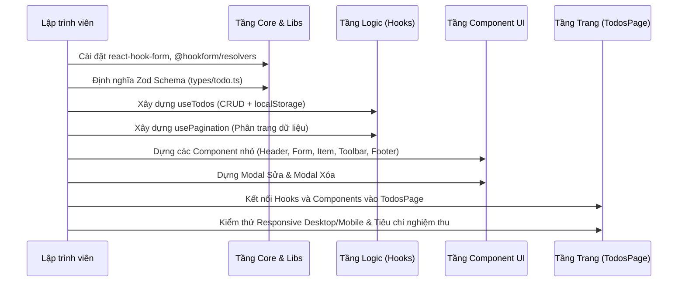

# Kế Hoạch Quy Trình Phát Triển Ứng Dụng To-Do (PROCESS.md)

Tài liệu này tổng hợp toàn bộ quy trình, đặc tả kiến trúc, phân rã component và lộ trình triển khai chi tiết cho sản phẩm **To-Do Application** bám sát thiết kế mẫu (Desktop & Mobile) và đáp ứng đầy đủ các yêu cầu kỹ thuật đề ra.

---

## 1. Mục tiêu & Yêu Cầu Dự Án

### 1.1. Yêu cầu chức năng
- **CRUD Dữ liệu cục bộ (Local State):** Tạo mới, xem danh sách, cập nhật trạng thái (hoàn thành/chưa hoàn thành), chỉnh sửa tiêu đề và xóa công việc.
- **Lưu trữ bền vững (Persistence):** Lưu trữ danh sách vào `localStorage`, tự động khôi phục khi tải lại trang.
- **Tìm kiếm & Lọc (Search & Filter):**
  - Tìm kiếm tức thời theo từ khóa tiêu đề công việc.
  - Lọc trạng thái: Tất cả (`All`), Đang làm (`Active`), Đã hoàn thành (`Completed`).
- **Form nhập liệu & Xác thực (Form & Validation):**
  - Sử dụng `React Hook Form` kết hợp `Zod` schema.
  - Chặn chuỗi rỗng, chuỗi chỉ chứa khoảng trắng, giới hạn độ dài hợp lệ.
  - Hiển thị thông báo lỗi chi tiết theo từng trường (field-level error message).
- **Hộp thoại (Modal / Dialog):**
  - Modal chỉnh sửa tiêu đề công việc.
  - Modal xác nhận trước khi thực hiện hành động xóa.
- **Phân trang (Pagination):** Chia nhỏ danh sách khi số lượng công việc vượt ngưỡng (ví dụ: 5 công việc/trang).
- **Bộ đếm & Trích dẫn (Footer Info):**
  - Hiển thị chính xác số công việc chưa hoàn thành (`Your remaining todos : X`).
  - Hiển thị câu trích dẫn mẫu bám sát thiết kế.

### 1.2. Yêu cầu kỹ thuật & Kiến trúc
- **Kiến trúc:** Tuân thủ cấu trúc 3 lớp của 365ejsc (`Shell → Core → Modules`), code nghiệp vụ nằm độc lập trong `src/modules/todos/`.
- **UI & Styling:** Tailwind CSS kết hợp thư viện thành phần nguyên bản (Shadcn UI base-nova trên nền `@base-ui/react`).
- **Logic Separation:** Tách toàn bộ logic nghiệp vụ, xử lý state và phân trang vào các Custom Hook riêng biệt.
- **Độ chuẩn xác UI:** Khớp tối thiểu 90% so với thiết kế mẫu cả trên Desktop và Mobile.

---

## 2. Phân Tích Thiết Kế Giao Diện (UI/UX Breakdown)

```
+--------------------------------------------------------------+
|                         Your To Do                           |
|                                                              |
|  [ Add new task...                             ] [ + ]       |
|                                                              |
|  +--------------------------------------------------------+  |
|  | [x] This is an example of task #1                  [x] |  |
|  +--------------------------------------------------------+  |
|  | [ ] This is an example of task #2                  [x] |  |
|  +--------------------------------------------------------+  |
|  | [x] This is an example of task #3                  [x] |  |
|  +--------------------------------------------------------+  |
|  | [ ] This is an example of task #4                  [x] |  |
|  +--------------------------------------------------------+  |
|  | [ ] This is an example of task #5                  [x] |  |
|  +--------------------------------------------------------+  |
|                                                              |
|  Your remaining todos : 3                                    |
|  "Doing what you love is the cornerstone of having           |
|  abundance in your life." - Wayne Dyer                       |
+--------------------------------------------------------------+
```

### Chi tiết các thành phần giao diện:
1. **Khung chứa chính (Container):**
   - Nền trắng tinh gọn, bóng mờ nhẹ hoặc viền mềm.
   - Chiều rộng giới hạn (`max-w-md` đến `max-w-lg`) trên Desktop, co giãn linh hoạt 100% trên Mobile.
2. **Tiêu đề (Header):**
   - Font chữ Inter, độ đậm `font-bold` hoặc `font-semibold`, kích thước lớn rõ ràng (`text-2xl` - `text-3xl`).
3. **Ô nhập liệu (Input & Button):**
   - Input có đường viền gạch chân hoặc bo viền tối giản xám nhạt, placeholder màu xám nhạt (`Add new task`).
   - Nút thêm `+`: Nền đen / xám đậm, bo góc vuông mềm (`rounded-lg`), biểu tượng dấu cộng căn giữa.
4. **Hàng công việc (Todo Item):**
   - Bao bọc bởi hình chữ nhật bo góc tròn (`rounded-xl`), viền xám sáng (`border-zinc-200`).
   - **Checkbox bên trái:** 
     - Chưa hoàn thành: Vuông bo góc nhẹ, viền rỗng.
     - Đã hoàn thành: Nền đen/xám đậm, có dấu tick màu trắng.
   - **Nội dung ở giữa:**
     - Chưa hoàn thành: Màu chữ đen/xám đậm thông thường.
     - Đã hoàn thành: Hiệu ứng gạch ngang (`line-through`), màu chữ xám nhạt (`text-zinc-400`).
   - **Nút xóa bên phải:** Biểu tượng `×` mảnh, chuyển màu rõ khi di chuột (hover state).
5. **Chân trang (Footer):**
   - Dòng đếm: `Your remaining todos : <số_lượng>`.
   - Câu trích dẫn: Dòng chữ nghiêng (`italic`), kích thước chữ nhỏ, căn dưới cùng.

---

## 3. Cấu Trúc Phân Rã Component (Component Hierarchy)

```text
src/modules/todos/
├── module.ts                    # Khai báo module và route động cho Shell
├── types/
│   └── todo.ts                  # Zod Schema & TypeScript types
├── hooks/
│   ├── use-todos.ts             # Custom hook quản lý dữ liệu CRUD, lọc & persistence
│   └── use-pagination.ts        # Custom hook quản lý logic phân chia trang
├── components/
│   ├── todo-header.tsx          # Tiêu đề "Your To Do"
│   ├── todo-input-form.tsx      # Form nhập liệu + Validation Zod
│   ├── todo-toolbar.tsx         # Thanh tìm kiếm và bộ lọc trạng thái
│   ├── todo-list.tsx            # Danh sách các task & Empty State
│   ├── todo-item.tsx            # Từng thẻ công việc (Checkbox, title, nút xóa/sửa)
│   ├── todo-pagination.tsx      # Bộ nút điều hướng phân trang
│   ├── todo-footer.tsx          # Hiển thị số task còn lại và câu quote
│   ├── todo-edit-modal.tsx      # Modal chỉnh sửa tiêu đề công việc
│   └── todo-delete-modal.tsx    # Modal xác nhận trước khi xóa
└── pages/
    └── todos-page.tsx           # Page lắp ráp toàn bộ các component và hooks
```

---

## 4. Đặc Tả Dữ Liệu & Schema Xác Thực

### 4.1. Entity Schema
- `id`: Chuỗi định danh duy nhất (UUID string).
- `title`: Tiêu đề công việc (chuỗi ký tự).
- `completed`: Trạng thái hoàn thành (boolean).
- `createdAt`: Mốc thời gian tạo (chuỗi ISO datetime).

### 4.2. Form Validation Schema (Zod)
- **Quy tắc bắt buộc:**
  - Không được để trống hoặc chỉ nhập toàn khoảng trắng (`trim()`).
  - Độ dài tối thiểu: 2 ký tự.
  - Độ dài tối đa: 100 ký tự.
- **Thông báo lỗi trực quan:**
  - Để trống: *"Vui lòng nhập nội dung công việc"*
  - Dưới 2 ký tự: *"Nội dung công việc phải có ít nhất 2 ký tự"*
  - Quá 100 ký tự: *"Nội dung công việc không được vượt quá 100 ký tự"*

---

## 5. Đặc Tả Custom Hooks (Tách Logic Nghiệp Vụ)

### 5.1. Hook `useTodos`
- **Nhiệm vụ:** Đảm nhiệm 100% logic dữ liệu của tính năng To-Do.
- **Quản lý trạng thái:**
  - `todos`: Danh sách công việc lưu trong state, tự đồng bộ với `localStorage` qua `useEffect`.
  - `searchQuery`: Từ khóa tìm kiếm công việc.
  - `filterStatus`: Bộ lọc (`all` | `active` | `completed`).
- **Các hàm & giá trị phơi bày (Exposed API):**
  - `addTodo(title: string)`: Thêm mới công việc vào danh sách.
  - `toggleTodo(id: string)`: Đảo ngược trạng thái hoàn thành.
  - `updateTodo(id: string, newTitle: string)`: Cập nhật tiêu đề sau khi chỉnh sửa.
  - `deleteTodo(id: string)`: Xóa hẳn công việc khỏi danh sách.
  - `setSearchQuery(query: string)`: Cập nhật từ khóa tìm kiếm.
  - `setFilterStatus(status)`: Cập nhật bộ lọc hiện tại.
  - `remainingCount`: Giá trị tính toán số lượng công việc chưa hoàn thành (`completed === false`).
  - `filteredTodos`: Danh sách công việc sau khi áp dụng đồng thời bộ lọc trạng thái và tìm kiếm.

### 5.2. Hook `usePagination`
- **Nhiệm vụ:** Chia nhỏ danh sách dữ liệu cho từng trang hiển thị.
- **Đầu vào (Input):**
  - `items`: Danh sách mảng dữ liệu đầu vào.
  - `pageSize`: Số lượng item trên một trang (mặc định: 5).
- **Đầu ra (Output):**
  - `currentPage`: Trang hiện tại (bắt đầu từ 1).
  - `totalPages`: Tổng số trang được tính toán động.
  - `paginatedItems`: Mảng dữ liệu tương ứng với trang hiện hành.
  - `goToPage(page: number)`: Nhảy tới trang mong muốn.
  - `nextPage()` / `prevPage()`: Chuyển trang tiếp theo hoặc trang trước.

---

## 6. Quy Trình Triển Khai Chi Tiết Từng Bước (Roadmap)



### Bước 1: Chuẩn bị Thư viện & Module
1. Cài đặt các gói hỗ trợ form: `react-hook-form`, `@hookform/resolvers`.
2. Tạo thư mục module mới: `src/modules/todos/` với đầy đủ các thư mục con theo kiến trúc chuẩn: `types/`, `hooks/`, `components/`, `pages/`.
3. Tạo file `src/modules/todos/module.ts` để đăng ký module tự động vào Router hệ thống.

### Bước 2: Thiết lập Types & Schema
1. Khởi tạo file định nghĩa schema tại `src/modules/todos/types/todo.ts`.
2. Định nghĩa các kiểu TypeScript dẫn xuất từ Zod schema (`z.infer`).

### Bước 3: Hiện thực Logic với Custom Hooks
1. Xây dựng hook `useTodos` tại `src/modules/todos/hooks/use-todos.ts`.
2. Xây dựng hook `usePagination` tại `src/modules/todos/hooks/use-pagination.ts`.
3. Kiểm tra tính toàn vẹn của logic: Đảm bảo dữ liệu ghi và đọc mượt mà từ `localStorage`.

### Bước 4: Xây dựng Bộ Thành Phần Giao Diện (Components)
1. **`TodoHeader`:** Căn chỉnh tiêu đề font Inter sắc nét.
2. **`TodoInputForm`:** Áp dụng `useForm` với resolver Zod, bắt sự kiện Submit, reset form sau khi thêm, xử lý hiển thị lỗi validate nếu có.
3. **`TodoItem`:** Dựng thẻ task bo góc xám với checkbox tùy biến theo ảnh mẫu (nền đen khi tick, gạch ngang text khi hoàn thành).
4. **`TodoList`:** Duyệt mảng `paginatedItems` để render `TodoItem`, hiển thị thông điệp khi danh sách trống.
5. **`TodoToolbar` & `TodoPagination`:** Tích hợp thanh tìm kiếm, các nút filter và bộ phân trang.
6. **`TodoEditModal` & `TodoDeleteModal`:** Tích hợp hộp thoại xác nhận xóa và form sửa tiêu đề.
7. **`TodoFooter`:** Hiển thị dòng đếm và câu trích dẫn mẫu.

### Bước 5: Ghép Trang Hoàn Chỉnh & Tinh Chỉnh Giao Diện
1. Ghép nối toàn bộ component vào `TodosPage` tại `src/modules/todos/pages/todos-page.tsx`.
2. Đặt `defaultPath` hoặc redirect route `/` về `/todos` để khi mở app là vào thẳng màn hình To-Do.
3. Tinh chỉnh CSS Tailwind:
   - Khoảng cách lề, kích thước viền, bóng mờ, màu sắc checkbox.
   - Thử nghiệm trên khung nhìn Desktop (màn hình rộng) và Mobile (kích thước ~390px).

### Bước 6: Kiểm Thử & Nghiệm Thu
1. Chạy lệnh kiểm tra cú pháp và kiểu: `pnpm typecheck`.
2. Chạy lệnh kiểm tra tiêu chuẩn code: `pnpm lint`.
3. Chạy lệnh kiểm tra ranh giới kiến trúc: `pnpm check:modules`.
4. Chạy kiểm tra bản đóng gói: `pnpm build`.
5. Đối chiếu trực quan sản phẩm trên trình duyệt với ảnh thiết kế mẫu để đạt độ chuẩn xác ≥ 90%.

---

## 7. Bảng Tiêu Chí Đánh Giá Nghiệm Thu (Acceptance Criteria)

| STT | Tiêu chí đánh giá | Yêu cầu kỹ thuật chi tiết | Trọng số |
|:---:|---|---|:---:|
| 1 | **Độ khớp thiết kế UI** | Đúng font, đúng màu, checkbox đen khi hoàn thành, text gạch ngang, nút + đen bo vuông mềm, đúng quote chân trang (≥ 90% so với ảnh mẫu). | 25% |
| 2 | **Độ phản hồi Responsive** | Hiển thị mượt mà trên cả Desktop (căn giữa cân đối) và Mobile (co giãn tự nhiên, không vỡ layout, không thanh cuộn ngang). | 15% |
| 3 | **Chức năng CRUD & Persistence** | Thêm mới, đánh dấu xong, sửa tiêu đề, xóa hoạt động chính xác 100%; tự lưu và khôi phục từ `localStorage`. | 20% |
| 4 | **Form & Validation** | Sử dụng React Hook Form + Zod; chặn rỗng/khoảng trắng, báo lỗi field rõ ràng. | 15% |
| 5 | **Tìm kiếm, Lọc & Phân trang** | Tìm kiếm thời gian thực, lọc 3 trạng thái, phân trang mượt mà khi danh sách nhiều việc. | 10% |
| 6 | **Tách biệt Logic (Custom Hooks)** | Logic CRUD và phân trang được tách hoàn toàn vào `useTodos` và `usePagination`, component chỉ làm nhiệm vụ hiển thị UI. | 10% |
| 7 | **Chất lượng mã nguồn** | Không có lỗi trong console trình duyệt, vượt qua `pnpm typecheck`, `pnpm lint`, `pnpm build`. | 5% |

---
*Tài liệu này đóng vai trò kim chỉ nam cho quá trình hiện thực hóa ứng dụng To-Do theo đúng thiết kế và yêu cầu kỹ thuật.*
